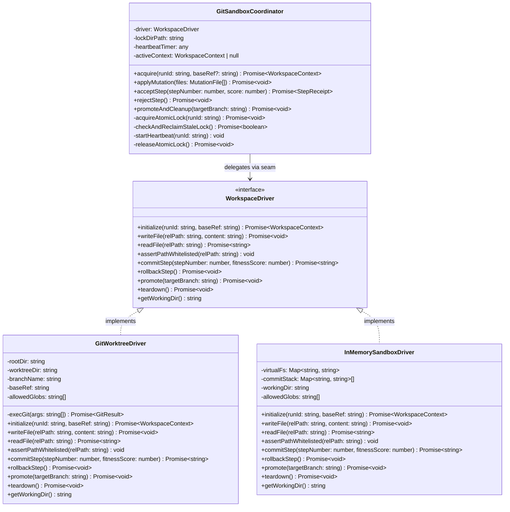
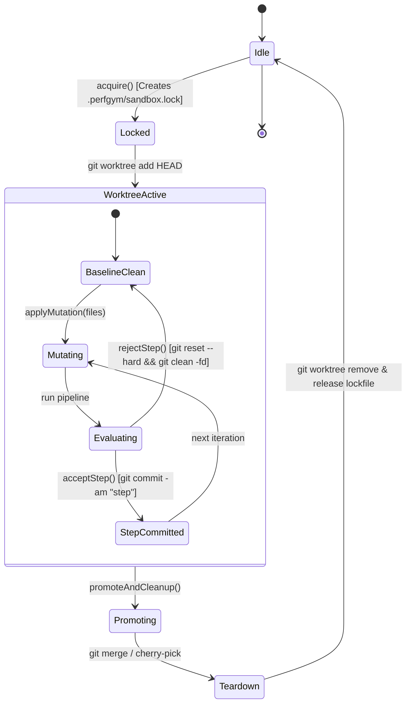
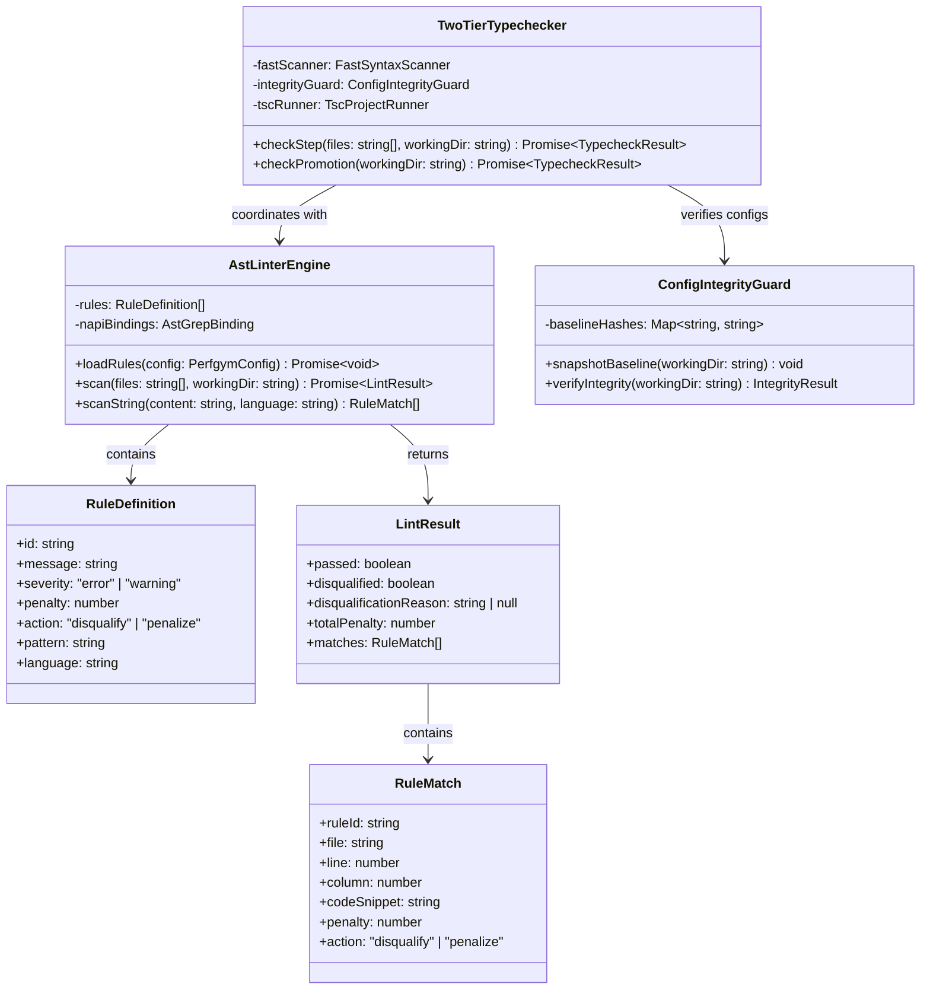
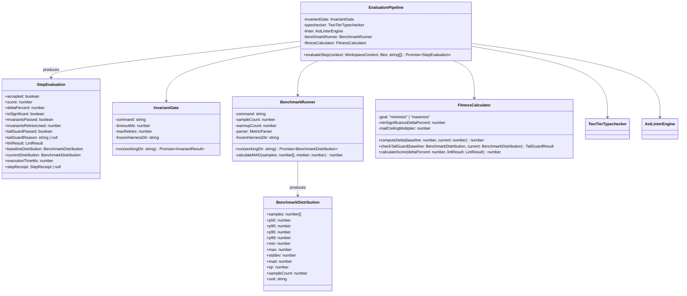
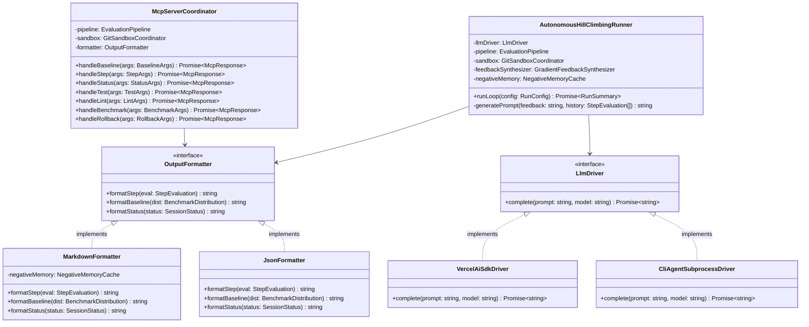
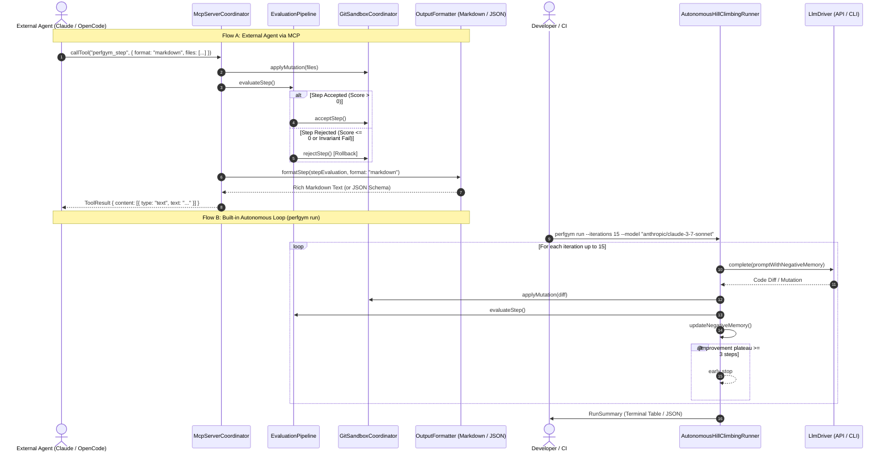

# 📐 PerfGym Low-Level Design (LLD) Specifications & Diagrams

This document specifies the low-level architecture, class structures, execution sequences, state machines, and data schemas for all four core subsystems of **PerfGym**.

---

## 📑 Table of Contents
1. [Core Architectural Principles](#1-core-architectural-principles)
2. [Feature 1: Workspace Sandbox & Rollback Sentinel](#2-feature-1-workspace-sandbox--rollback-sentinel)
3. [Feature 2: AST Pattern Linter & Anti-Cheating Gate](#3-feature-2-ast-pattern-linter--anti-cheating-gate)
4. [Feature 3: Invariant & Deterministic Fitness Pipeline](#4-feature-3-invariant--deterministic-fitness-pipeline)
5. [Feature 4: CLI Runner, Agent MCP Server & Autonomous Loop](#5-feature-4-cli-runner-agent-mcp-server--autonomous-loop)
6. [Cross-Cutting Data Schemas (Markdown & JSON Mode)](#6-cross-cutting-data-schemas-markdown--json-mode)

---

## 1. Core Architectural Principles

PerfGym follows the **Deep Module Design** pattern:
- **Small Interface, Deep Implementation:** Callers (CLI commands or AI agents via MCP) invoke concise methods (`baseline()`, `step()`). Complex worktree coordination, sub-30ms git rollbacks, AST parsing, and statistical percentile calculations remain private.
- **Explicit Seams with Dual Concrete Adapters:**
  - `WorkspaceDriver`: `GitWorktreeDriver` (production) & `InMemorySandboxDriver` (unit tests).
  - `TypecheckDriver`: `BiomeSyntaxDriver` (per-step fast tier) & `TscProjectDriver` (pre-promotion full tier).
  - `LinterEngine`: `AstGrepNapiDriver` (in-process Rust binding) & `FallbackPatternDriver` (regex fallback).
  - `MetricCollector`: `SubprocessMetricDriver` (standard shell runner) & `InstructionCounterDriver` (Linux perf/V8 profiler).

---

## 2. Feature 1: Workspace Sandbox & Rollback Sentinel

### 2.1 Low-Level Class Diagram


### 2.2 Sequence Diagram: Mutation, Step Evaluation & Rollback
```mermaid
sequenceDiagram
    autonumber
    actor Agent as AI Agent (MCP / CLI)
    participant Coord as GitSandboxCoordinator
    participant Driver as GitWorktreeDriver
    participant OS as Local FileSystem / Git

    Agent->>Coord: acquire(runId: "run-402")
    Coord->>OS: Atomic mkdir .perfgym/.lock.d/ (O_EXCL semantics)
    opt If lock exists
        Coord->>OS: Check lock metadata (PID, heartbeat). Is PID alive?
        alt PID dead or heartbeat > 30s
            Coord->>OS: Break stale lock, run git worktree prune, reclaim
        else PID active
            Coord-->>Agent: Throw ERR_SANDBOX_LOCKED (busy)
        end
    end
    Coord->>Driver: initialize("run-402", "HEAD")
    Driver->>OS: git worktree add .perfgym/worktrees/run-402 HEAD
    Driver->>OS: git checkout -b perfgym/eval-run-402
    Driver-->>Coord: WorkspaceContext { worktreeDir, branch }
    Coord-->>Agent: Ready

    Note over Agent, OS: Mutation Phase (Iteration 1)
    Agent->>Coord: applyMutation([{ path: "src/calc.ts", content: "..." }])
    Coord->>Driver: writeFile("src/calc.ts", content)
    Driver->>Driver: assertPathWhitelisted("src/calc.ts")
    Driver->>OS: fs.writeFileSync(worktreeDir + "/src/calc.ts")
    
    Note over Agent, OS: Evaluation Phase (Regression detected)
    Agent->>Coord: rejectStep()
    Coord->>Driver: rollbackStep()
    Driver->>OS: git reset --hard HEAD
    Driver->>OS: git clean -ffd (removes untracked ignored poison files)
    Driver->>OS: git submodule foreach --recursive git reset --hard
    Note over Driver, OS: Rollback completes in <30ms; worktree clean
    Coord-->>Agent: Rollback verified

    Note over Agent, OS: Mutation Phase (Iteration 2 - Valid Speedup)
    Agent->>Coord: applyMutation([{ path: "src/calc.ts", content: "..." }])
    Coord->>Driver: writeFile("src/calc.ts", content)
    Agent->>Coord: acceptStep(step: 2, score: 28.5)
    Coord->>Driver: commitStep(step: 2, score: 28.5)
    Driver->>OS: git add -A
    Driver->>OS: git commit -m "perfgym(step 2): +28.5% fitness"
    Driver-->>Coord: commitSha: "a9f3b1c"
    Coord-->>Agent: StepReceipt { commitSha, step: 2, status: "COMMITTED" }
```

### 2.3 State Machine: Workspace Sandbox Lifecycle


---

## 3. Feature 2: AST Pattern Linter & Anti-Cheating Gate

### 3.1 Low-Level Class Diagram


### 3.2 Sequence Diagram: Two-Tier Typecheck & Anti-Cheating Verification
```mermaid
sequenceDiagram
    autonumber
    participant Pipeline as EvaluationPipeline
    participant TypeGate as TwoTierTypechecker
    participant Guard as ConfigIntegrityGuard
    participant Linter as AstLinterEngine
    participant Napi as @ast-grep/napi (Rust/C++ in-process)

    Pipeline->>TypeGate: checkStep(modifiedFiles, worktreeDir)
    
    Note over TypeGate, Guard: Integrity Gate: verify tsconfig.json & test files
    TypeGate->>Guard: verifyIntegrity(worktreeDir)
    alt Hash mismatch in tsconfig.json or tests
        Guard-->>TypeGate: Tampering detected
        TypeGate-->>Pipeline: TypecheckResult { passed: false, disqualified: true, reason: "Integrity violation: tsconfig/tests modified" }
        Note over Pipeline: Immediately aborts pipeline; Score = -Infinity
    end

    Note over TypeGate: Tier 1: Fast Syntax, Dynamic Eval & Suppression Scan (<50ms)
    TypeGate->>Napi: scanForPatterns("// @ts-ignore", "// @ts-nocheck", "as any", "eval($$$)", "Function($$$)")
    alt Type Suppression or Dynamic Eval Found & action == "disqualify"
        TypeGate-->>Pipeline: TypecheckResult { passed: false, disqualified: true, reason: "Forbidden @ts-ignore or dynamic eval" }
        Note over Pipeline: Immediately aborts pipeline; Score = -Infinity
    else Clean Syntax
        TypeGate-->>Pipeline: TypecheckResult { passed: true }
    end

    Pipeline->>Linter: scan(modifiedFiles, worktreeDir)
    Note over Linter, Napi: In-process AST Match (<10ms)
    loop For each rule in rules.yaml
        Linter->>Napi: matchPattern(astRoot, rule.pattern)
        Napi-->>Linter: matchNodes[]
    end
    Linter-->>Pipeline: LintResult { totalPenalty: 30, matches: [ ... ] }
```

---

## 4. Feature 3: Invariant & Deterministic Fitness Pipeline

### 4.1 Low-Level Class Diagram


### 4.2 Sequence Diagram: 4-Stage Evaluation Cascade
```mermaid
sequenceDiagram
    autonumber
    participant Pipeline as EvaluationPipeline
    participant Invariants as InvariantGate
    participant TypeGate as TwoTierTypechecker
    participant Linter as AstLinterEngine
    participant Bench as BenchmarkRunner
    participant Calc as FitnessCalculator

    Note over Pipeline: Stage 1: Invariant Correctness Gate
    Pipeline->>Invariants: run(worktreeDir)
    alt Test Fails (exit code != 0)
        opt retries > 0
            Invariants->>Invariants: retry test command
        end
        alt Still Fails
            Invariants-->>Pipeline: InvariantResult { passed: false, error: "AssertionError" }
            Pipeline-->>Pipeline: Score = -Infinity; accepted = false
            Note over Pipeline: Abort immediately, return StepEvaluation
        end
    end
    Invariants-->>Pipeline: InvariantResult { passed: true }

    Note over Pipeline: Stage 2: Anti-Cheating & AST Linter
    Pipeline->>TypeGate: checkStep(files)
    TypeGate-->>Pipeline: Passed
    Pipeline->>Linter: scan(files)
    Linter-->>Pipeline: LintResult { totalPenalty: 10, disqualified: false }

    Note over Pipeline: Stage 3: Deterministic Benchmark Sampling
    Pipeline->>Bench: run(worktreeDir) [N=5 samples + 1 warmup]
    Bench-->>Pipeline: BenchmarkDistribution { p50: 12.1ms, p99: 15.0ms, max: 16.2ms }

    Note over Pipeline: Stage 4: Fitness & Tail Guard Calculation
    Pipeline->>Calc: checkTailGuard(baselineDist, currentDist)
    alt Tail Spike Exceeds Robust Ceiling (Current_p99 > Baseline_p50 + 3 * Baseline_MAD)
        Calc-->>Pipeline: TailGuardResult { passed: false, reason: "p99 degraded beyond 3*MAD ceiling" }
        Pipeline-->>Pipeline: accepted = false; Score = -Infinity
    else Tail Guard OK
        Calc-->>Pipeline: TailGuardResult { passed: true }
        Pipeline->>Calc: computeDelta(baselineDist.p50, currentDist.p50)
        Calc-->>Pipeline: deltaPercent = +28.0%
        alt deltaPercent < minSignificanceDelta (2.5%)
            Pipeline-->>Pipeline: Score = 0; accepted = false (Rejected: Insignificant noise gain)
        else Statistically Significant Win
            Pipeline->>Calc: calculateScore(deltaPercent: 28.0, totalPenalty: 10)
            Calc-->>Pipeline: score = +18.0
            Pipeline-->>Pipeline: accepted = (score > 0) -> true
        end
    end
```

---

## 5. Feature 4: CLI Runner, Agent MCP Server & Autonomous Loop

### 5.1 Low-Level Class Diagram


### 5.2 Sequence Diagram: MCP Stdio Request vs Built-in Loop


---

## 6. Cross-Cutting Data Schemas (Markdown & JSON Mode)

Every CLI command and MCP response supports dual output formatting (`markdown` and `json`).

### 6.1 Step Evaluation Schema (JSON Mode)
When `--format json` or `{ "format": "json" }` is requested:

```json
{
  "status": "REVERTED",
  "accepted": false,
  "score": -12.4,
  "deltaPercent": -2.4,
  "isSignificant": false,
  "executionTimeMs": 340,
  "invariants": {
    "passed": true,
    "retriesUsed": 0,
    "command": "pnpm test:invariants",
    "durationMs": 85
  },
  "typecheck": {
    "passed": true,
    "tier": "fast-syntax",
    "disqualified": false
  },
  "linter": {
    "passed": false,
    "disqualified": false,
    "totalPenalty": 10,
    "matches": [
      {
        "ruleId": "no-await-in-loop",
        "file": "src/checkout/process.ts",
        "line": 42,
        "column": 9,
        "message": "Avoid serial awaits inside loops; use Promise.all or chunking.",
        "penalty": 10,
        "action": "penalize",
        "codeSnippet": "const item = await fetchItem(id);"
      }
    ]
  },
  "metrics": {
    "target": "latency_p50",
    "unit": "ms",
    "goal": "minimize",
    "baseline": {
      "p50": 42.1,
      "p90": 48.0,
      "p95": 51.2,
      "p99": 58.0,
      "min": 40.2,
      "max": 62.1,
      "stddev": 3.4,
      "mad": 1.2,
      "iqr": 2.1,
      "sampleCount": 5
    },
    "current": {
      "p50": 43.1,
      "p90": 49.2,
      "p95": 53.0,
      "p99": 61.2,
      "min": 41.0,
      "max": 65.4,
      "stddev": 4.1,
      "mad": 1.5,
      "iqr": 2.6,
      "sampleCount": 5
    },
    "tailGuard": {
      "passed": true,
      "madCeiling": 45.7,
      "rule": "Current_p99 <= Baseline_p50 + 3 * Baseline_MAD"
    }
  },
  "stepReceipt": null,
  "negativeMemoryGuidance": "Previously failed attempt in step 3 tried batching with 500 items, which exceeded socket pool timeout. Keep batch size <= 50."
}
```

### 6.2 Step Evaluation Schema (Markdown Mode)
When `--format markdown` (default) is requested:

```markdown
### ❌ [REVERTED] Mutation in `src/checkout/process.ts` (Score: -12.4)

The mutation degraded performance and violated AST performance guidelines. Your changes were safely rolled back in **24ms**.

#### 1. Invariants & Types
- **Unit / Invariant Tests:** ✅ 100% Passed (85ms)
- **Typecheck Gate:** ✅ Clean (no type suppressions)

#### 2. Performance Distribution (Baseline vs Mutation)
| Metric | Baseline | Current Mutation | Delta |
|---|---|---|---|
| **Median (p50)** | `42.1ms` | `43.1ms` | 🔻 **+2.4% slower** |
| **p95** | `51.2ms` | `53.0ms` | 🔻 `+3.5%` |
| **p99 (Tail)** | `58.0ms` | `61.2ms` | 🔻 `+5.5%` (Tail Guard passed) |
| **Max Spike** | `62.1ms` | `65.4ms` | 🔻 `+5.3%` |

#### 3. AST Pattern Violations (-10 Penalty Points)
- **`src/checkout/process.ts:42`** — `no-await-in-loop` (penalty: -10)
  ```ts
  42: const item = await fetchItem(id);
  ```
  *Recommendation: Batch IDs into `fetchItemsChunk([id1, id2])` or wrap with `Promise.all`.*

#### 4. Negative Memory & Next Action
- ⚠️ *Do not attempt serial awaits or loop lookups — this pattern regressed latency in steps 2 and 4.*
- 👉 *Next Direction: Optimize `process.ts` by pulling the query outside the loop using an in-memory hash map.*
```
